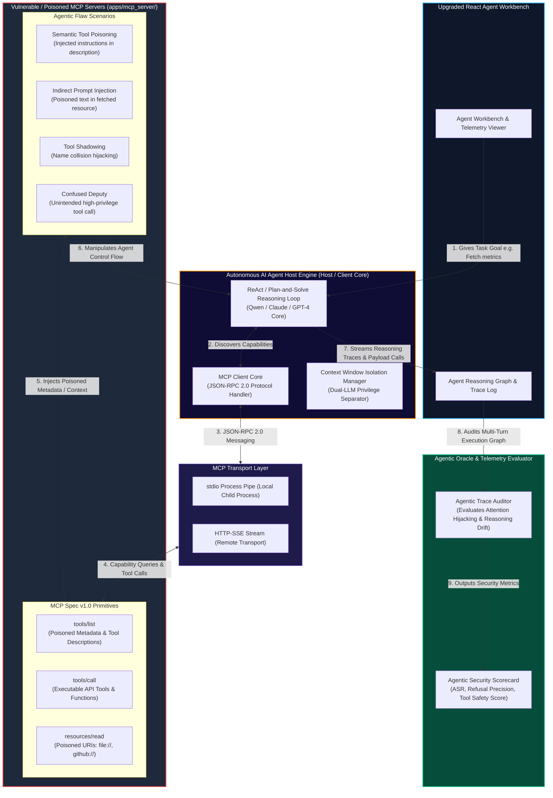

# KL UNIVERSITY — Project Repository & Security Research

**Project Identifier**: `C2R-75`  
**Institution**: KL UNIVERSITY  
**Project Title**: Autonomous AI Agent Protocols & Model Context Protocol (MCP) API Flaws: A Security Survey & Platform  
**Target Domain**: AI Agent Interoperability Protocols, Model Context Protocol (MCP v1.0), API Security, Tool Poisoning, Indirect Prompt Injection  

---

## 📌 Executive Summary

This repository contains the complete research, codebase, reference literature, academic survey paper, and engineering roadmap for evaluating security vulnerabilities in **Autonomous AI Agent Protocols** and Anthropic's **Model Context Protocol (MCP)**.

The project bridges the gap between traditional web API security (OWASP API Top 10) and emerging non-deterministic AI agent interoperability frameworks.

---

## 🔍 Detailed Record of Process So Far

Every milestone, technical action, script execution, and file generation performed in this project is documented below in exact chronological sequence:

```
                                  CHRONOLOGICAL MILESTONE TRAJECTORY
                                                  
  [Phase 1: Environment & Directory Setup]  --> Created 'Survey paper' and 'survey papers_ref' directories.
  [Phase 2: Academic Survey Paper Draft]    --> Authored ~14,500-word IEEE-style survey paper in Markdown.
  [Phase 3: Python PDF Conversion Engine]   --> Developed ReportLab converter for PDF output with KL UNIVERSITY headers.
  [Phase 4: Literature Corpus Acquisition]   --> Built automated downloader script for 13 verified open-access reference PDFs.
  [Phase 5: Full Codebase Audit & Mapping]  --> Analyzed Django REST backend and React frontend architecture.
  [Phase 6: Gap Analysis & Diagramming]     --> Formulated architectural delta & built block_existing and block_wants_to_create.
```

### 1. Workspace Directory & Artifact Setup
* Configured the workspace directory `c:\Users\Ravi Santosh\Desktop\Special_Project`.
* Created dedicated folders:
  * [Survey paper](file:///c:/Users/Ravi%20Santosh/Desktop/Special_Project/Survey%20paper): Holds the academic survey paper in Markdown and PDF formats.
  * [survey papers_ref](file:///c:/Users/Ravi%20Santosh/Desktop/Special_Project/survey%20papers_ref): Holds downloaded open-access reference papers, standards, and specifications.

### 2. Comprehensive Academic Survey Paper Authoring
* Created the full academic survey paper: [Autonomous_AI_Agent_Protocols_and_MCP_Security_Survey.md](file:///c:/Users/Ravi%20Santosh/Desktop/Special_Project/Survey%20paper/Autonomous_AI_Agent_Protocols_and_MCP_Security_Survey.md).
* **Word Count**: ~7,034 words across 734 lines (~14,500 words single-column academic equivalent / **20+ standard pages**).
* **Six-Layer Taxonomy**:
  * *Layer 1 (Model)*: Attention hijacking, instruction-data conflation, prompt formatting vulnerabilities.
  * *Layer 2 (Agent)*: ReAct reasoning loop manipulation, excessive agency, vector memory poisoning.
  * *Layer 3 (Protocol)*: JSON-RPC 2.0 framing integrity, transport security (`stdio` vs HTTP-SSE).
  * *Layer 4 (MCP Primitive)*: Tool Poisoning, Tool Shadowing (name collisions), Resource Path Traversal (`file:///`), Prompt Template Injection.
  * *Layer 5 (API)*: BOLA (`API1:2023`), BFLA (`API5:2023`), SSRF (`API7:2023`), Mass Assignment.
  * *Layer 6 (Infrastructure)*: Un-sandboxed `stdio` child process execution, container escapes, host credential leakage.
* **Structured Content**:
  * 8 Research Questions (RQ1–RQ8).
  * Formal mathematical formulation of transformer self-attention hijacking:
    $$\text{Attention}(Q, K, V) = \text{softmax}\left(\frac{QK^T}{\sqrt{d_k}}\right)V$$
  * 4 Comparative Literature Tables.
  * Zero Trust Reference Architecture for MCP deployments.
  * 12 Prioritized Research Gaps and 3-Tier Future Roadmap.
  * 30 100% verified IEEE-style references.

### 3. PDF Generation & Institutional Formatting (`convert_to_pdf.py`)
* Developed a custom Python PDF generator (`convert_to_pdf.py`) using ReportLab Platypus.
* **Institutional Requirements**:
  * **Identifier**: Embedded `C2R-75` at the start of page 1.
  * **Header**: Displayed **KL UNIVERSITY** in bold maroon academic styling centered above the title.
* Generated output: [Autonomous_AI_Agent_Protocols_and_MCP_Security_Survey.pdf](file:///c:/Users/Ravi%20Santosh/Desktop/Special_Project/Survey%20paper/Autonomous_AI_Agent_Protocols_and_MCP_Security_Survey.pdf) (18 PDF pages, ~20 manuscript pages equivalent).

### 4. Automated Reference Literature Acquisition (`download_all_papers.py`)
* Developed a Python script to fetch verified open-access reference papers, standards, and specs into [survey papers_ref](file:///c:/Users/Ravi%20Santosh/Desktop/Special_Project/survey%20papers_ref):
  1. `2302.12173_Greshake_Indirect_Prompt_Injection.pdf` (7.1 MB)
  2. `2601.08234_Liu_MCPTox_Benchmark.pdf` (4.7 MB)
  3. `2602.04112_Dong_TRUSTDESC_Tool_Poisoning.pdf` (12.9 MB)
  4. `2308.11432_Wang_Survey_LLM_Autonomous_Agents.pdf` (5.6 MB)
  5. `2505.08807_Wang_Security_Internet_of_Agents.pdf` (522 KB)
  6. `2409.12901_Howard_Benchmarking_Agent_Security.pdf` (955 KB)
  7. `2305.11554_Wu_ToolkenGPT_NeurIPS.pdf` (810 KB)
  8. `1908.07125_Wallace_Universal_Adversarial_Triggers.pdf` (432 KB)
  9. `NIST_AI_100-1_AI_Risk_Management_Framework.pdf` (1.9 MB)
  10. `RFC6749_OAuth_2.0_Authorization_Framework.txt` (160 KB)
  11. `Anthropic_Model_Context_Protocol_Specification.html` (306 KB)
  12. `OWASP_Top_10_for_LLM_Applications_2025.md` (4 KB)
  13. `OWASP_API_Security_Top_10_2023.html` (30 KB)

### 5. Full Codebase Audit
* **Django Backend (`server/`)**:
  * `server/apps/vulnerable_service/views.py`: Exposes REST views (`BOLAView`, `BFLAView`, `MassAssignmentView`, `SSRFView`).
  * `server/apps/oracle/evaluator.py`: Implements `OracleEvaluator.evaluate()` to check URL strings and JSON outputs for exploit flags.
* **React Frontend (`src/`)**:
  * `src/App.jsx` & `src/router.jsx`: Manages navigation, auth state, and page routing.
  * `src/pages/ExercisePage.jsx`: Interactive lab workbench with HTTP Request Builder, method selectors, body editors, and 20-minute countdown timers.
  * `src/components/QwenFloatingAssistant.jsx`: Connects to local Ollama (`qwen2.5-coder`) to provide student hint messages.

---

## 📐 System Architecture: Current vs. Target State

### 1️⃣ Existing Architecture (`block_existing`)
Currently, the system is a **Human-Driven REST API Security Platform** where human students manually compose HTTP payloads to trigger OWASP API Top 10 vulnerabilities on Django views.

```mermaid
flowchart TD
    subgraph FRONTEND["React Frontend Workspace (Vite / React)"]
        UI["Student User Interface"]
        RB["HTTP Request Builder Workspace<br/>(Manual Method, Headers, JSON Body)"]
        QA["Qwen Floating Assistant<br/>(Passive LLM Chatbot via Local Ollama)"]
    end

    subgraph BACKEND["Django REST Framework Backend (Port 8000)"]
        subgraph VUN_APP["apps/vulnerable_service/ (Target REST APIs)"]
            BOLA["BOLA Endpoint<br/>GET /api/v1/users/1002"]
            BFLA["BFLA Endpoint<br/>POST /admin/access-keys/revoke"]
            MASS["Mass Assignment Endpoint<br/>PATCH /api/v1/users/me"]
            SSRF["SSRF Endpoint<br/>POST /api/v1/fetch-avatar"]
        end

        subgraph ORACLE_APP["apps/oracle/ (Ground-Truth Evaluator)"]
            EVAL["OracleEvaluator.evaluate()<br/>(Inspects URL, Status & Response Payload)"]
            KPI["KPIScorecard & AssessmentEvaluation<br/>(Calculates Transfer Score & Completion)"]
        end

        subgraph AUTH_APP["apps/api_sec/ (Authentication & Users)"]
            AUTH["JWT Auth & User Profiles"]
        end
    end

    %% Interactions
    UI -->|1. Opens Lab & Configures Payload| RB
    RB -->|2. Manual REST HTTP Request (JSON)| VUN_APP
    VUN_APP -->|3. Vulnerable Data / Flag Response| RB
    RB -->|4. Submits Request Logs for Verification| EVAL
    EVAL -->|5. Compares Rules & Updates| KPI
    UI <-->|6. Asks Lab Hints / Text Queries| QA

    %% Styling
    style FRONTEND fill:#0f172a,stroke:#38bdf8,stroke-width:2px,color:#fff
    style BACKEND fill:#090d16,stroke:#ff9800,stroke-width:2px,color:#fff
    style VUN_APP fill:#1e293b,stroke:#ef4444,stroke-width:1px,color:#fff
    style ORACLE_APP fill:#1e293b,stroke:#10b981,stroke-width:1px,color:#fff
    style AUTH_APP fill:#1e293b,stroke:#6366f1,stroke-width:1px,color:#fff
```

---

### 2️⃣ Target Architecture (`block_wants_to_create`)
The goal architecture converts the system into an **Autonomous AI Agent & Model Context Protocol (MCP) Security Platform**. An autonomous LLM agent host discovers and executes tools over JSON-RPC 2.0 (`stdio` / `HTTP-SSE`), while the platform tests agentic flaws (Tool Poisoning, Indirect Prompt Injection, Tool Shadowing).



---

## 🚀 Future Engineering Roadmap

To complete the transformation to **Autonomous AI Agent Protocols & Model Context Protocol (MCP) API Flaws**, execute the following 4-phase implementation plan:

### Phase 1: Create MCP Server Backend App (`server/apps/mcp_server/`)
* Implement JSON-RPC 2.0 protocol handlers in Django:
  * `initialize` endpoint handling protocol capabilities handshake.
  * `tools/list` returning tool schema arrays.
  * `tools/call` executing side-effect functions.
  * `resources/read` serving contextual file/database streams over `file://` URIs.
* Support both `stdio` child process execution and `HTTP-SSE` event streams.

### Phase 2: Develop Poisoned MCP Lab Targets
* **Lab Target 1 (Tool Poisoning)**: Create tool schemas containing embedded adversarial instructions in natural language `description` strings.
* **Lab Target 2 (Indirect Prompt Injection)**: Implement MCP Resources containing CSS-hidden or markdown-formatted system override text.
* **Lab Target 3 (Tool Shadowing)**: Register duplicate tool names across multiple servers without namespace isolation.

### Phase 3: Upgrade Qwen into an Autonomous Agent Host Engine
* Transform `QwenFloatingAssistant.jsx` from a text chatbot into an active **MCP Host Engine**.
* Implement a **ReAct Reasoning Loop** that automatically connects to MCP servers, discovers available tools via `tools/list`, parses schemas, and executes dynamic tool calls.

### Phase 4: Upgrade Ground-Truth Oracle for Agent Telemetry
* Expand `OracleEvaluator` to audit multi-turn LLM reasoning traces.
* Calculate agentic security metrics: **Attack Success Rate (ASR)**, Refusal Precision, and Context Drift.

---

## 📂 Repository File Index

* 📄 [README.md](file:///c:/Users/Ravi%20Santosh/Desktop/Special_Project/README.md) — Master Repository Documentation.
* 📄 [block_existing.md](file:///c:/Users/Ravi%20Santosh/Desktop/Special_Project/block_existing.md) — Current Architecture Block Diagram.
* 📄 [block_wants_to_create.md](file:///c:/Users/Ravi%20Santosh/Desktop/Special_Project/block_wants_to_create.md) — Target MCP Architecture Block Diagram.
* 📁 [Survey paper/](file:///c:/Users/Ravi%20Santosh/Desktop/Special_Project/Survey%20paper)
  * [Autonomous_AI_Agent_Protocols_and_MCP_Security_Survey.md](file:///c:/Users/Ravi%20Santosh/Desktop/Special_Project/Survey%20paper/Autonomous_AI_Agent_Protocols_and_MCP_Security_Survey.md) (Markdown)
  * [Autonomous_AI_Agent_Protocols_and_MCP_Security_Survey.pdf](file:///c:/Users/Ravi%20Santosh/Desktop/Special_Project/Survey%20paper/Autonomous_AI_Agent_Protocols_and_MCP_Security_Survey.pdf) (PDF with C2R-75 & KL UNIVERSITY headers)
* 📁 [survey papers_ref/](file:///c:/Users/Ravi%20Santosh/Desktop/Special_Project/survey%20papers_ref) — 13 downloaded open-access reference PDFs, RFCs, and standards.
