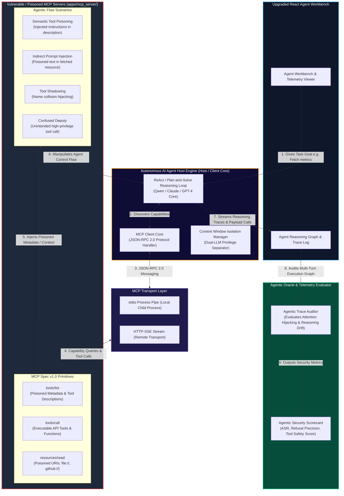

# Target Architecture: Autonomous AI Agent Protocols & Model Context Protocol (MCP) Security Platform (`block_wants_to_create`)

## Detailed Description of Target Architecture
1. **Model Context Protocol (MCP v1.0) Integration**: Implementation of JSON-RPC 2.0 message handlers (`initialize`, `tools/list`, `tools/call`, `resources/read`, `prompts/get`) over `stdio` and HTTP-SSE transports.
2. **Autonomous Agent Host Engine**: Replacing manual human request building with an autonomous LLM reasoning engine (ReAct loop) that discovers capabilities and executes API calls dynamically.
3. **Agentic Flaw Testbed**:
   * **Semantic Tool Poisoning**: Malicious metadata in tool `description` fields.
   * **Indirect Prompt Injection**: Infected resources ingested into the agent context window.
   * **Tool Shadowing**: Un-namespaced duplicate tool definitions hijacking calls.
4. **Agentic Oracle Evaluator**: Audits multi-turn LLM reasoning traces, measuring **Attack Success Rate (ASR)**, refusal precision, and semantic context drift.
