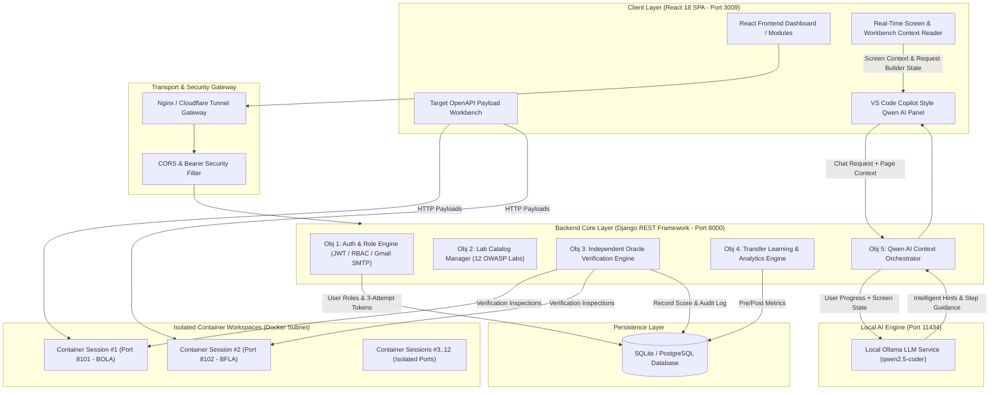
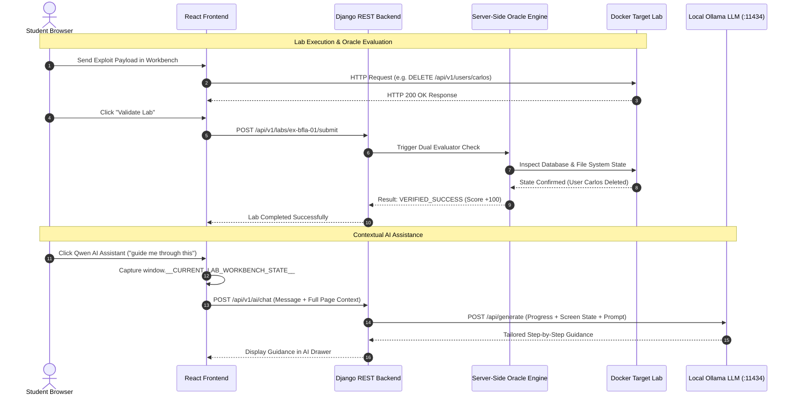
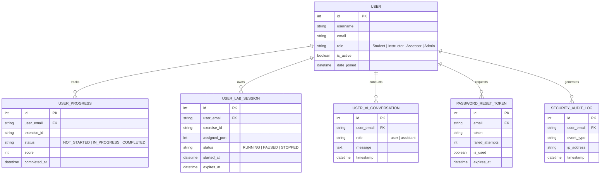

# 3. Complete System Architecture and Detailed Design
## HackTheAPI // OWASP API Security Training & Assessment Platform

---

## 🏛️ 1. High-Level System Topology

**HackTheAPI** is built on a 5-layer decoupled architecture separating the Client UI, Security Gateway, Backend REST Services, Container Workspaces, and Local AI Engine.



---

## 🎯 2. Detailed 5-Objective Architecture Mapping

### **Objective 1: Multi-Tenant RBAC & Auth Sequence**

```mermaid
sequenceDiagram
    autonumber
    actor User as Student / Instructor / Admin
    participant SPA as React Frontend (:3009)
    participant API as Django REST Backend (:8000)
    participant SMTP as Gmail SMTP (:587)
    participant DB as System Database

    User->>SPA: Submit Login Credentials
    SPA->>API: POST /api/v1/auth/user/login
    API->>DB: Validate Username & Password Hash
    DB-->>API: User Record & Role Claims
    API-->>SPA: Return JWT Access & Refresh Tokens

    Note over User, SMTP: Password Reset Flow (3-Attempt Threshold)
    User->>SPA: Request Password Reset
    SPA->>API: POST /api/v1/auth/reset-password/request
    API->>SMTP: Dispatch 6-Digit OTP Token
    SMTP-->>User: Deliver Verification Email
    User->>SPA: Submit Verification Code
    SPA->>API: POST /api/v1/auth/reset-password/confirm
    alt Attempt <= 3 and Code Correct
        API->>DB: Update Password Hash & Nullify Token
        API-->>SPA: Password Successfully Updated
    else Attempt > 3 or Code Invalid
        API->>DB: Increment failed_attempts; Revoke Token
        API-->>SPA: Token Revoked (Too Many Attempts)
    end
```

---

### **Objective 3 & 5: Oracle Verification & Ollama AI Sequence**



---

## 🗄️ 3. Database Entity-Relationship Diagram (ERD)



---

## 🔌 4. Network Port Matrix

| Service Component | Port | Network Interface | Protocol | Description |
|---|---|---|---|---|
| **Vite React Frontend** | `3009` | `0.0.0.0` | HTTP / WebSockets | Client UI SPA |
| **Django REST Backend** | `8000` | `127.0.0.1` | HTTP | Backend API Core |
| **Local Ollama Service** | `11434` | `127.0.0.1` | HTTP / JSON | Local LLM (`qwen2.5-coder`) |
| **Target Lab Workspaces** | `8101 - 8112` | `127.0.0.1` | HTTP | Docker Target Lab Containers |
